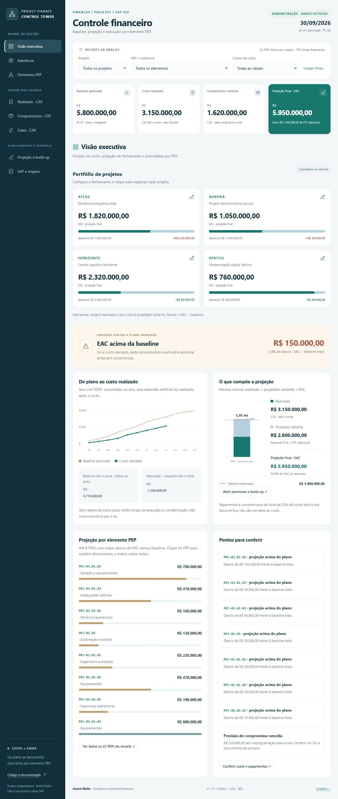
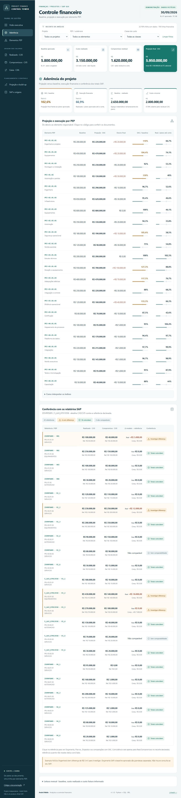
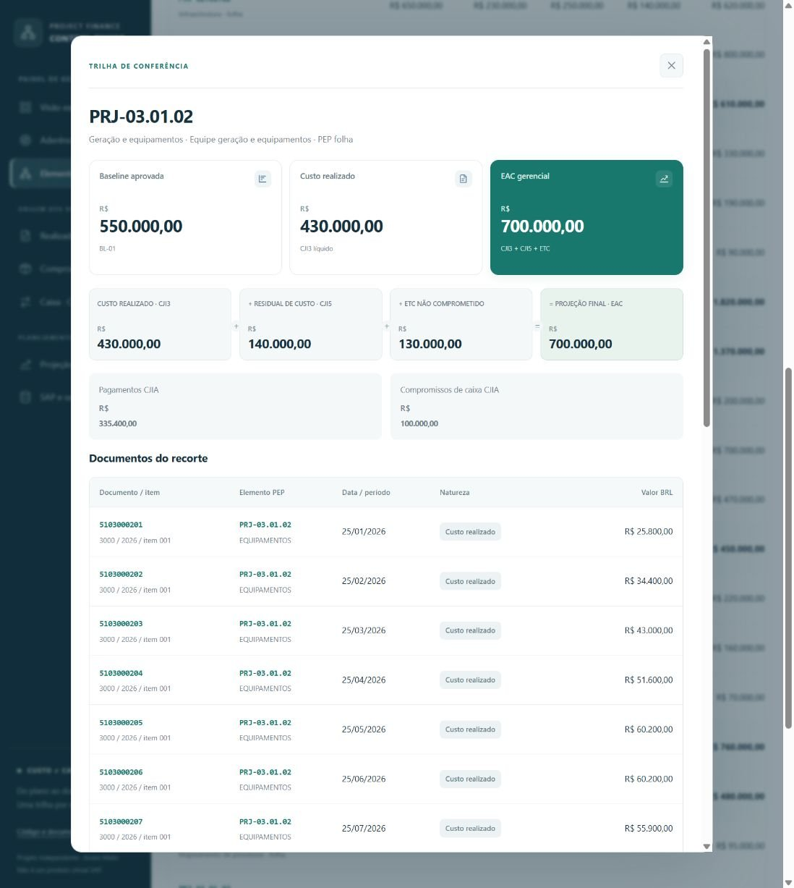
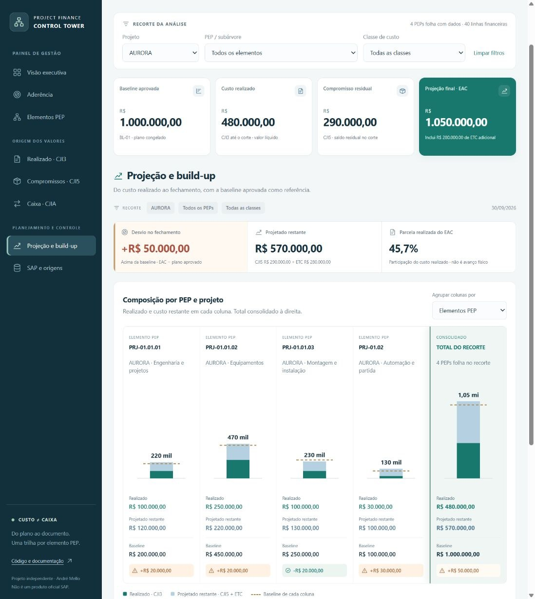

# SAP Project Financial Control Tower

**Controle financeiro de projetos por elemento PEP, com rastreabilidade do indicador ao documento de origem.**

Painel para acompanhar baseline, custos realizados, compromissos, projeção e caixa de projetos SAP. Permite explorar indicadores consolidados e consultar os documentos que explicam sua composição, a partir de arquivos CSV normalizados.

Desenvolvido em **Python, SQL, HTML, CSS e JavaScript**, gera relatórios que podem ser consultados no navegador, inclusive offline.


[Demonstração online](https://andremellotech.github.io/sap-project-financial-control-tower/) · [Guia de uso](docs/user-guide.md) · [Contrato de dados](docs/data-contract.md) · [Guia SAP GUI](docs/sap-gui-guide.md)

> **Em desenvolvimento:** projeto de portfólio de [André Mello](https://github.com/andremellotech), com dados inteiramente fictícios. Implementação independente, sem conexão ativa com o SAP e sem vínculo oficial com a SAP.



## Visão geral

A proposta é facilitar a leitura do desempenho financeiro de projetos, conectando a visão executiva ao detalhamento de custos, compromissos e pagamentos.

A solução recebe **arquivos CSV normalizados**, preparados a partir de exportações autorizadas. O processamento gera um relatório HTML autocontido, acompanhado de arquivos para consulta e conferência.

**Não há conexão ativa com o SAP.** A implementação é independente, sem uso de logotipos, telas ou dados de empresas.

## Principais recursos

- **Visão consolidada:** baseline, realizado, compromissos e projeção de custo final.
- **Análise por elemento PEP:** navegação hierárquica, subtotais e fichas de detalhamento.
- **Composição da projeção:** separação entre realizado, compromisso residual e estimativa adicional.
- **Perspectiva de caixa:** pagamentos e compromissos de pagamento apresentados separadamente dos custos.
- **Rastreabilidade:** identificação dos documentos, arquivos e linhas de origem.
- **Conferência:** comparação dos indicadores com referências externas.
- **Exportação:** consulta e extração dos registros selecionados.
- **Uso offline:** abertura da demonstração local pelo navegador.

## Tecnologias utilizadas

| Tecnologia | Papel no projeto |
|---|---|
| **Python 3.11+** | Leitura dos arquivos, validação das bases e geração dos relatórios |
| **SQL e SQLite** | Estruturação dos dados e execução das consultas analíticas |
| **HTML e CSS** | Estrutura e apresentação da interface |
| **JavaScript** | Filtros, navegação e interações do relatório |
| **Node.js** | Execução das verificações JavaScript |
| **GitHub Actions** | Fluxos de validação configurados para Windows e Ubuntu |
| **GitHub Pages** | Publicação da demonstração estática, quando habilitado |

A geração utiliza a biblioteca padrão do Python, sem dependências externas. A interface não depende de CDN ou serviços externos.

## Perguntas que o painel ajuda a responder

- Quais elementos PEP apresentam projeção acima do plano aprovado?
- Como o custo final estimado se divide entre realizado, compromissos e estimativas adicionais?
- Quais documentos e classes de custo explicam os indicadores?
- Quais pagamentos possuem vínculo de conciliação demonstrado?
- Qual arquivo e linha deram origem a cada registro?

## Modelo financeiro

O modelo mantém separadas as perspectivas de **custo**, **projeção** e **caixa**.

| Fonte | Aplicação no projeto | Critério de interpretação |
|---|---|---|
| **CJI3 — Realizado** | Custo realizado líquido por PEP e documento, com liquidações apresentadas separadamente | Custo realizado não equivale a pagamento nem a avanço físico |
| **CJI5 — Compromissos** | Saldo residual de requisições e pedidos de compra na data de corte | O saldo residual não representa o valor original do pedido nem uma posição de caixa |
| **CJIA — Caixa** | Pagamentos realizados e compromissos de pagamento, apresentados separadamente | Os valores de caixa não são adicionados à projeção de custo final |
| **Plano aprovado** | Baseline mensal congelada e identificada por versão | A baseline não equivale automaticamente ao orçamento SAP |
| **Premissas gerenciais** | Estimativa de custo futuro adicional, ainda não coberta pelos compromissos | As estimativas não devem repetir compromissos já considerados |

O contrato analítico é próprio do projeto e não representa um layout universal SAP. A disponibilidade dos relatórios, o significado dos campos e os critérios de extração precisam ser validados no ambiente de uso.

Referência: [relatórios de partidas individuais de projetos da SAP](https://help.sap.com/docs/SAP_S4HANA_ON-PREMISE/69c3a05bb8d44f02bdd2abe5e822da8e/ae05b753128eb44ce10000000a174cb4.html).

### Indicadores principais

| Indicador | Definição no modelo |
|---|---|
| **Baseline** | Plano aprovado utilizado como referência de comparação |
| **Custo realizado** | Custo registrado até a data de corte |
| **Compromisso residual** | Parcela de custo comprometida e ainda não realizada, conforme os critérios das bases |
| **ETC adicional** | Estimativa de custo futuro não coberta pelos compromissos considerados |
| **EAC gerencial** | Estimativa de custo ao término do projeto |

```text
EAC gerencial = custo realizado + compromisso residual de custo + ETC adicional

Desvio final = EAC − baseline total aprovada

Desvio até o corte = custo realizado − baseline aprovada até o corte
```

O desvio final indica se a projeção está acima ou abaixo da baseline. O desvio até o corte compara realizado e plano acumulado, sem comprovar, isoladamente, economia, atraso ou avanço físico.

**Pagamentos e compromissos de caixa não compõem a soma do EAC.**

Consulte a [documentação dos indicadores](docs/metrics.md) para detalhes sobre sinais, liquidações e limitações.

## Perspectivas de análise

| Perspectiva | Conteúdo |
|---|---|
| **Visão executiva** | Indicadores consolidados, curva acumulada e pontos de atenção |
| **Elementos PEP** | Hierarquia, subtotais e ficha por elemento, com valores contabilizados nas folhas |
| **Realizado · CJI3** | Custos, créditos e liquidações, com pesquisa e exportação da seleção |
| **Compromissos · CJI5** | Requisições e pedidos de compra, itens, alocações, previsões e saldos residuais |
| **Caixa · CJIA** | Pagamentos, compromissos de caixa e vínculos explícitos de conciliação |
| **Projeção** | Composição do EAC por PEP ou projeto, premissas e simulação local de sensibilidade do ETC |
| **SAP e origens** | Critérios de extração, roteiros de consulta, hashes e arquivos do snapshot |
| **Aderência** | Comparação entre projeção e baseline, leitura mensal e conferência com referências externas |

### Aderência e conferência



A análise de aderência permite comparar os indicadores com referências externas, preservando os campos informados nas bases.

O exemplo de **ZOVRPS005** utiliza rótulos fornecidos pelo usuário e dados fictícios. O **S_ALR_87013558** é outra referência possível de extração, descrita na documentação de [relatórios de projeto da SAP](https://help.sap.com/docs/SUPPORT_CONTENT/prosys/3363505772.html).

Não há adaptador automático nem fórmula local presumida para o campo **Disposto**. A baseline permanece separada do orçamento informado na referência externa.

### Detalhamento por PEP



Consulte os documentos e registros que sustentam os indicadores, mantendo a referência ao arquivo e à linha de origem.

### Composição da projeção



Analise a projeção por PEP ou projeto, com total consolidado do recorte e identificação das premissas utilizadas.

## Dados da demonstração

A demonstração utiliza exclusivamente **dados fictícios**, preparados para explorar situações como:

- Projeções acima ou abaixo da baseline.
- Créditos e liquidações.
- Compromissos com previsão vencida.
- Pagamentos parciais.
- Pagamentos sem alocação de custo demonstrada.
- Registros com e sem vínculo explícito de conciliação.

Os cenários ilustram o funcionamento do modelo e não representam resultados reais, clientes ou empresas.

> Um registro não conciliado não indica automaticamente dívida ou erro no SAP. A interpretação depende das evidências e dos vínculos disponíveis nas bases.

Consulte os [cenários da demonstração](docs/demo-scenarios.md).

## Como executar

### Abrir a demonstração

Para uso offline, extraia o pacote e abra:

```text
index.html
```

Para acesso pela web, utilize a [demonstração online](https://andremellotech.github.io/sap-project-financial-control-tower/), quando o GitHub Pages estiver habilitado.

### Gerar um relatório

**Requisito:** Python 3.11 ou superior.

Na pasta do projeto, execute:

```bash
python -m finance build --input sample-input --manifest config/manifest.json --output local-output/primeira-execucao
```

Em seguida, abra:

```text
local-output/primeira-execucao/index.html
```

O processo valida as entradas antes de criar a saída e não sobrescreve pastas existentes.

São gerados:

- Relatório HTML autocontido.
- Arquivos JSON e CSV.
- Banco SQLite com as consultas SQL efetivamente executadas.

> Nos CSVs gerados, os valores financeiros numéricos são expressos em **centavos**.

### Recriar a demonstração versionada

```bash
python -m finance demo
```

### Utilizar dados próprios

1. Prepare cópias dos arquivos em `local-input/`.
2. Configure um manifesto local com `dados_ficticios: false`.
3. Execute o comando `build`, direcionando a saída para uma nova pasta em `local-output/`.
4. Confira os indicadores, as classificações e os vínculos de conciliação.

**O relatório incorpora registros e referências das bases de entrada. Mantenha arquivos e saídas com dados reais fora do repositório público.**

Mais detalhes no [guia de uso](docs/user-guide.md) e no [contrato de dados](docs/data-contract.md).

## Estrutura do projeto

```text
finance/           Leitura, validação, SQL e geração dos artefatos
sql/               Schema e views utilizados pelo motor
sample-input/      Bases CSV fictícias
config/            Manifesto: corte, versões, aprovação e arquivos
web/               Interface HTML, CSS e JavaScript
reports/demo/      Snapshot fictício: HTML, JSON, SQLite e CSVs
docs/              Uso, contrato, indicadores, SAP e publicação
tests/             Regras financeiras, exportação e filtros
.github/workflows/ Validação configurada para Windows e Ubuntu
index.html         Demonstração pronta para abrir ou publicar
```

## Verificações

Com Python e Node.js disponíveis, execute:

```bash
python -m unittest discover -s tests
node --check web/app.js
node --check web/metrics.js
node tests/test_metrics.cjs
```

Consulte o [registro de verificação](docs/verification.md).

## Escopo e limitações

O modelo trabalha com:

- CSVs normalizados em **UTF-8**, com separador `;`.
- Calendário civil e corte mensal.
- Valores em **BRL**, sem conversão de moedas.
- Premissas, classificações e conciliações validadas por quem prepara as bases.

Não estão contemplados:

- Importação direta de XLSX bruto.
- Conexão ativa com SAP ou automação de SAP GUI.
- Fornecimento de arquivo PBIX.
- Contabilização ou controle de disponibilidade orçamentária.
- Reconciliação bancária.
- Medição de avanço físico.
- Reprodução do cálculo SAP de redução de compromissos.
- Conciliação entre empresas.

## Possíveis evoluções

As possibilidades abaixo ainda não estão implementadas:

- Adaptadores para layouts de exportação autorizados.
- Histórico de snapshots.
- Previsão de caixa independente.
- Homologação com extratos reais.

## Contribuições

Sugestões de melhoria e relatos de problemas podem ajudar na evolução do projeto. Consulte as [orientações para contribuir](CONTRIBUTING.md).

Ao compartilhar exemplos, utilize apenas dados fictícios e descreva o comportamento esperado.

## Autoria e licença

Desenvolvido por **André Mello**.

[GitHub](https://github.com/andremellotech) · [LinkedIn](https://www.linkedin.com/in/aamello/)

Código e exemplos disponibilizados sob a [licença MIT](LICENSE).
